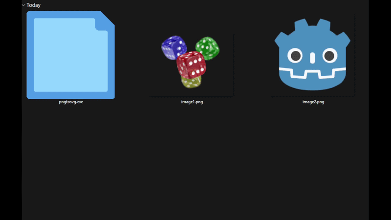

# PNGToSVG

[](https://crates.io/crates/pngtosvg)

A high-performance tool written in Rust that converts PNG raster images into SVG vectors.

*Note: This is a fast, standalone Rust rewrite of our original Python prototype. The old code is archived in [`/legacy_python`](./legacy_python).*

## Installation

**For Users:**
Download the standalone executable for your system from the [Releases](https://github.com/mayuso/PNGToSVG/releases) page. No dependencies required.

**For Developers:**
```bash
cargo install pngtosvg
```

## Usage

### Command Line (CLI)
```bash
pngtosvg image.png         # Convert a single file
pngtosvg ./assets/icons/   # Convert a specific folder
pngtosvg .                 # Convert the current directory

pngtosvg image.png > out.svg          # Redirected stdout: SVG is written there
cat image.png | pngtosvg - > out.svg  # Read PNG from stdin, SVG to stdout
pngtosvg image.png -o out.svg         # Write to a specific file (works in any shell)
pngtosvg image.png -o -               # Explicitly write to stdout
```
When stdout is a terminal, `image.svg` is written next to `image.png`. When stdout is redirected or piped, a single file's SVG goes to stdout instead and no file is created. `-o` works with a single file or stdin, not directories. Directories always write files.

*(Windows PowerShell 5.1 re-encodes `>` output as UTF-16, which corrupts the SVG. Use `-o out.svg` instead, or `cmd`, PowerShell 7+, or Git Bash.)*

*(Note for Linux/macOS: If not in your `PATH`, prefix the executable with `./`)*

### Windows Desktop GUI
You don't need the terminal to use this tool on Windows:
* **Drag & Drop:** Drag your `.png` files directly onto the executable.
* **Double Click:** Double-click the executable to automatically convert all images in the same folder.

<p align="center">
  
  
</p>

## Use as a Rust Library

Add the dependency to your project:
```bash
cargo add pngtosvg
```

**Minimal Example:**
```rust
use pngtosvg::convert_file_to_svg;
use std::path::Path;

fn main() {
    let svg_content = convert_file_to_svg(Path::new("image.png")).unwrap();
    println!("{}", svg_content);
}
```

For advanced features, including in-memory `RgbaImage` conversions, please read the **[official documentation on docs.rs](https://docs.rs/pngtosvg)**.
